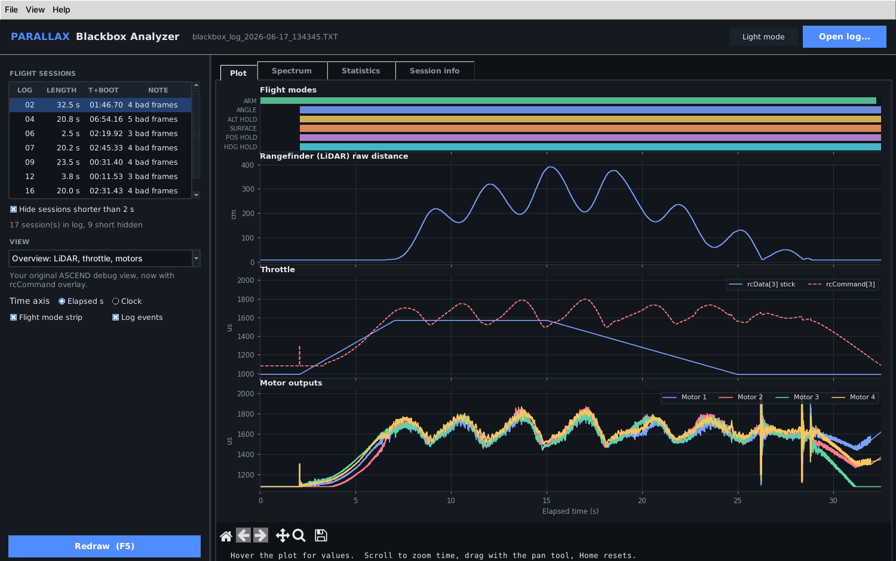
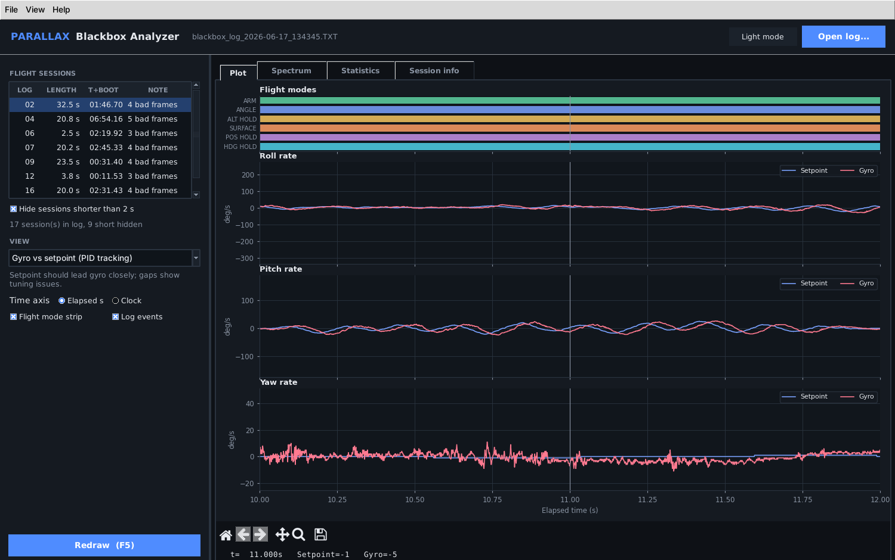
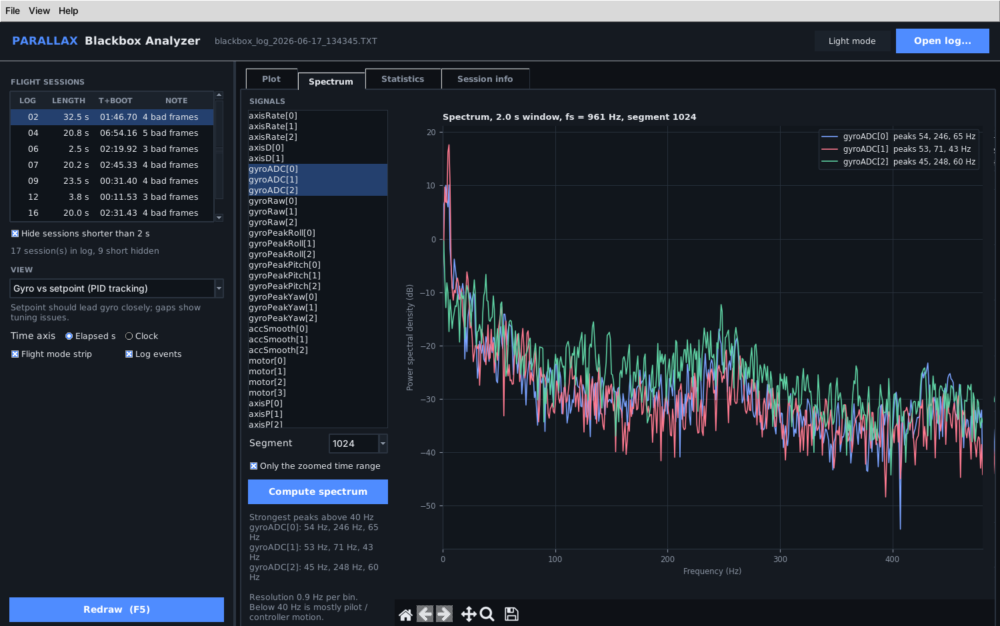

# Parallax Blackbox Analyzer

Desktop tool for decoding and inspecting INAV blackbox logs. Built while debugging **ASCEND**, Team Parallax's GPS-denied autonomous quadcopter (IRoC-U 2026), and packaged as a single Windows `.exe` that carries its own decoder.

Open a raw `.TXT` / `.BBL` log and the app decodes every flight session inside it, picks the real flight, and plots it. Decoded INAV CSVs and Parallax ground-station telemetry CSVs open directly.



## Download

Grab `ParallaxBlackboxAnalyzer.exe` from the [Releases](../../releases) page (or the latest *Build Windows exe* workflow run). No Python install needed. Windows SmartScreen may warn on first launch because the exe is unsigned: *More info → Run anyway*.

You can also drag a log file onto the exe, or set it as the "Open with" app for `.TXT` logs.

## What it does

| | |
|---|---|
| **One-click decode** | Bundled `blackbox_decode` runs in the background. Results are cached per log, so reopening is instant. |
| **Session picker** | Every log in the file with length, time since boot and bad-frame count. Short arm/disarm blips are hidden by default; the longest session opens first. |
| **Flight mode strip** | ARM, ANGLE, ALT HOLD, SURFACE, POS HOLD, failsafe and so on drawn as a timeline above the plots. Log events (sync beep, disarm) as markers. |
| **Debug views** | Overview (LiDAR, throttle, motors), altitude hold (baro vs LiDAR vs nav estimate vs target), gyro vs setpoint, PID terms, attitude, position hold, battery, vibration, Parallax telemetry, or any custom set of columns stacked or overlaid. |
| **Fast with big logs** | Min/max decimation keeps every spike visible and re-renders full resolution as you zoom. Mouse wheel zooms the time axis. |
| **Live readout** | Hover to see the exact value of every trace at that instant. |
| **Statistics** | Min, max, mean, std, RMS and peak-to-peak for the zoomed range, plus RMS tracking error for setpoint/gyro and target/estimate pairs. Copy as a table or export the range to CSV. |
| **Spectrum** | Welch PSD of gyro (or any signal) for the zoomed range with the strongest peaks above 40 Hz listed, for notch and filter tuning. |
| **Session info** | Firmware, PIDs, filters, looptime and every raw header, searchable. Flags when the FC clock was not set (common without GPS) and falls back to elapsed time. |
| **Dark and light themes** | Remembers theme, view, recent files and column picks between runs. |




### Shortcuts

`Ctrl+O` open, `Ctrl+S` save plot (PNG / PDF / SVG), `Ctrl+E` export zoomed range to CSV, `F5` redraw, `Home` reset zoom, mouse wheel zoom.

## Run from source

```bash
pip install -r analyzer/requirements.txt
make obj/blackbox_decode            # or put blackbox_decode(.exe) on PATH / set BLACKBOX_DECODE
python analyzer/run_analyzer.py [path/to/log.TXT]
```

Tests: `pip install pytest && python -m pytest analyzer/tests`

## Build the exe yourself

GitHub Actions builds it on every push (`.github/workflows/build-windows.yml`) and attaches it to a release when you push a `v*` tag. Locally on Windows with MSYS2:

```bash
make obj/blackbox_decode LDFLAGS="-static -pthread -lm"
pip install -r analyzer/requirements-build.txt
pyinstaller --noconfirm analyzer/ParallaxBlackboxAnalyzer.spec   # -> dist/ParallaxBlackboxAnalyzer.exe
```

## Repository layout

```
analyzer/            Python app (parallax_bb package), PyInstaller spec, tests
src/ Makefile        INAV blackbox-tools C sources (blackbox_decode, blackbox_render)
legacy/              The original blackbox_gui_analyzer.py and parallax_plotter.py
docs/                Upstream blackbox-tools README, ASCEND INAV CLI dump, screenshots
```

Decoded CSVs are cached in `%LOCALAPPDATA%\ParallaxBlackbox\decoded` (File → Clear decode cache).

## Credits and license

Built on [iNavFlight/blackbox-tools](https://github.com/iNavFlight/blackbox-tools) by Nicholas Sherlock and the INAV team; the upstream history is kept in this repo and its documentation is in [docs/BLACKBOX_TOOLS.md](docs/BLACKBOX_TOOLS.md). Licensed under GPLv3, see [LICENSE](LICENSE).
